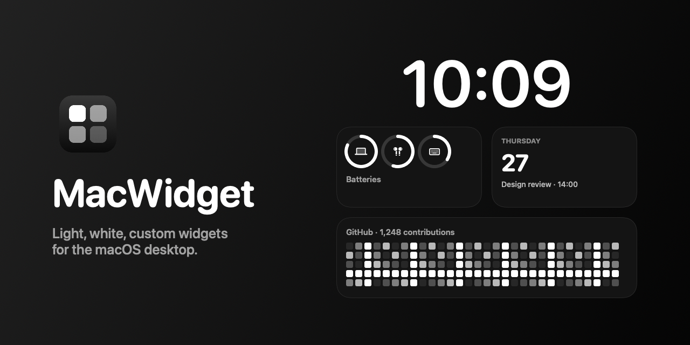

<h2 align="center">
MacWidget
</h2>

---

<div align="center">

</div>

<br/>

<div align="center">

[](https://forthebadge.com) &nbsp;
[](https://forthebadge.com) &nbsp;
[](https://www.swift.org) &nbsp;
[](https://www.apple.com/macos)

</div>

---

## About the Project

This project is a **light menu-bar app** that adds **custom white widgets** to the macOS widget gallery.

The main goal is to get clean, **customizable widgets** on the desktop while using **almost no CPU or memory**.

The app only wakes up on **system events** (power, Bluetooth, calendar changes), and widgets just display data it prepares in advance.

---

## Features

* ✅ **Big digital clock** with lock-screen style typography: font, weight, color, no background
* ✅ **Batteries** of the Mac, Magic accessories and AirPods, in **white** instead of green
* ✅ **Calendar** and **Mac resources** (CPU, memory, disk, thermal), one click opens Calendar or Activity Monitor
* ✅ **GitHub** contributions graph and latest commits
* ✅ **Apple Music** now playing, with album artwork and controls
* ✅ **Photo frames** with free cropping and a fill color behind transparent PNGs
* ✅ **Floating widgets** with truly **transparent** backgrounds, kept in place when the screen changes
* ✅ **Wallpapers**: still images, videos and **animated GIF / WebP / APNG**, paused when hidden

---

## Project Structure

```text
MAC-Widget/
├── App/            # Menu-bar app: data, floating widgets, wallpaper, settings
├── Widgets/        # WidgetKit extension (sandboxed, read-only)
├── Shared/         # Models and paths shared by the app and the widgets
├── Resources/      # Info.plist and entitlements
├── tools/          # Icon generator and local signing identity
└── build.sh        # Builds, signs and installs the app
```

---

## Installation

### Requirements

* **macOS 14** or later
* **Command Line Tools** with **Swift 6** (no Xcode needed)

### Setup

```bash
git clone https://github.com/Rudze/MAC-Widget
cd MAC-Widget
./build.sh
```

The app is installed in **/Applications** and starts in the **menu bar**.

To add a widget: right-click the desktop → **Edit Widgets…** → **MacWidget**.

---

## Contact

If you have any questions, feel free to reach out at contact@rudydavid.fr

---

### Show Your Support

Give a ⭐ if you like this project!
